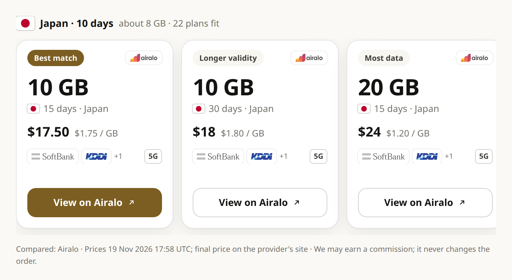
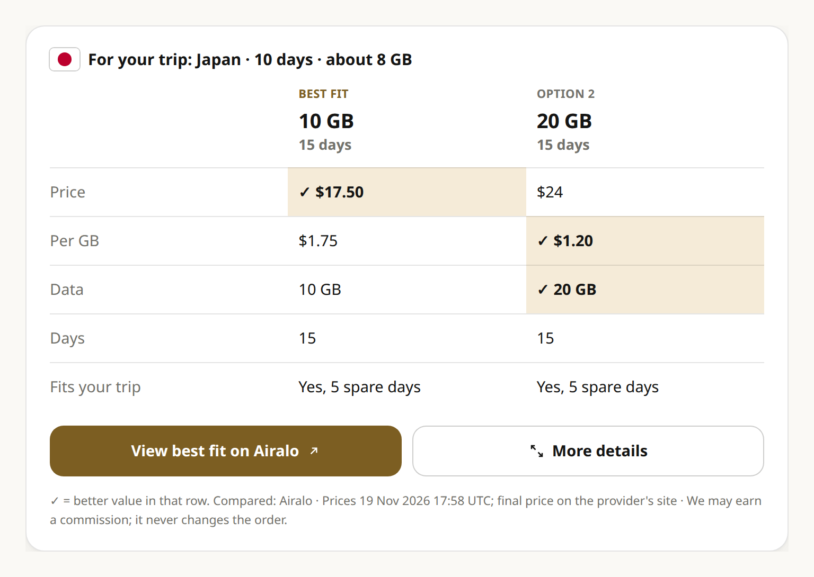
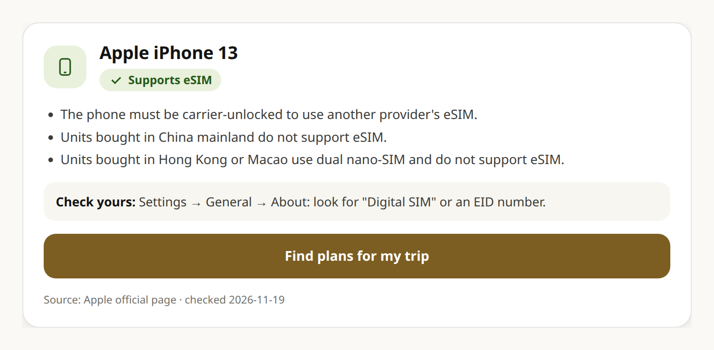
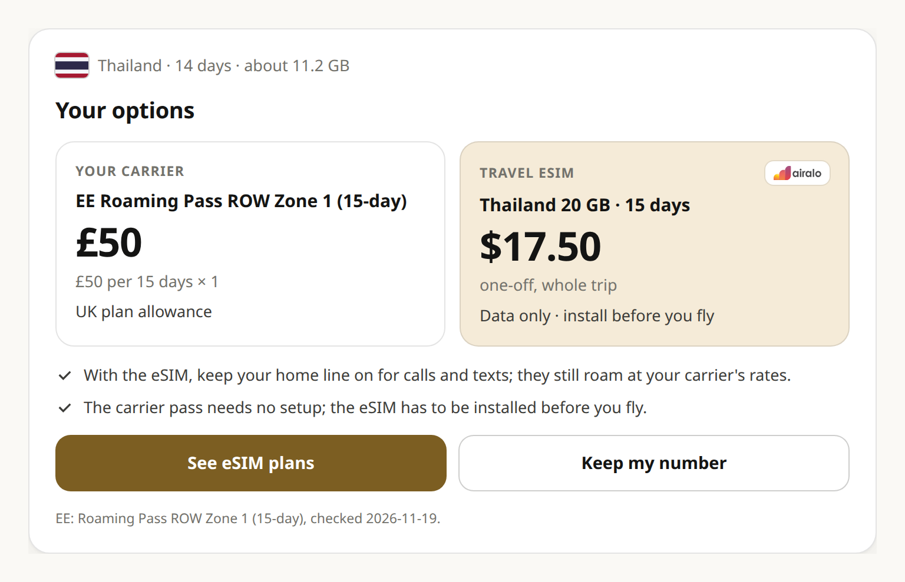
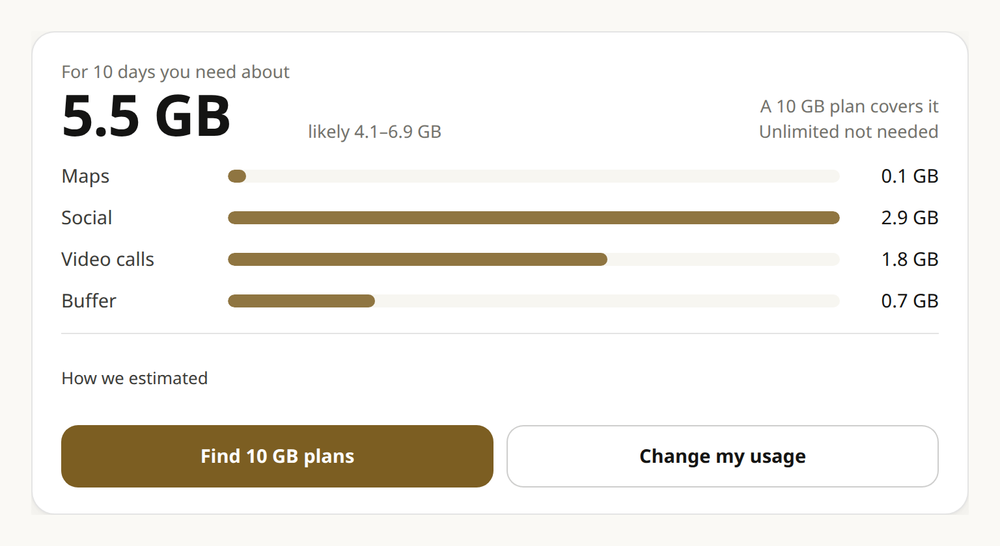
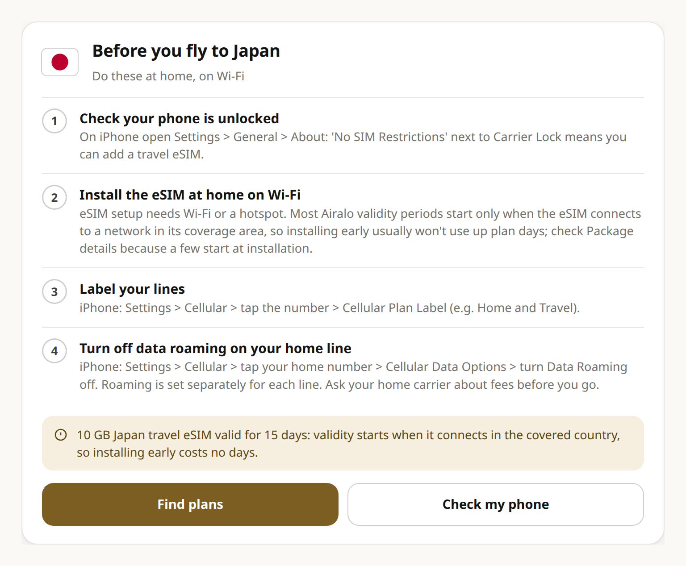

<p align="center">
  
</p>

<h1 align="center">OsmO Travel eSIM</h1>

<p align="center">
  <b>Ask your AI which travel eSIM to get.</b><br>
  A free, no-sign-in MCP server for Claude, ChatGPT, Cursor, VS Code, Gemini CLI and any MCP client.
  Tell it where you are going and for how long; it finds eSIM data plans that cover the whole trip
  (including multi-country trips), checks your phone supports eSIM, estimates your data, compares your
  carrier's roaming pass, and walks you through setup.
</p>

<p align="center">
  <a href="https://registry.modelcontextprotocol.io/v0.1/servers/app.getosmo.esim%2Ftravel-esim/versions/latest"></a>
  <a href="https://esim.getosmo.app"></a>
  <a href="LICENSE"></a>
</p>

<p align="center">
  <a href="https://cursor.com/en/install-mcp?name=osmo-travel-esim&config=eyJ1cmwiOiJodHRwczovL2VzaW0uZ2V0b3Ntby5hcHAvbWNwIn0="></a>
  <a href="https://vscode.dev/redirect/mcp/install?name=osmo-travel-esim&config=%7B%22type%22%3A%22http%22%2C%22url%22%3A%22https%3A%2F%2Fesim.getosmo.app%2Fmcp%22%7D"></a>
</p>

```
You:  Which eSIM should I get for 10 days in Japan? I use maps and Instagram.
AI:   (OsmO estimates about 8 GB, finds the plans that cover 10 days, and shows the best fits as cards.)
```

## What it looks like

In Claude and ChatGPT, answers come back as cards. Other MCP clients get the same answers as text.
*Screenshots use live catalogue data from the day they were taken; prices change.*

<table>
  <tr>
    <td width="50%"><br><sub>Plans that cover your trip, ranked by fit then price</sub></td>
    <td width="50%"><br><sub>Compare two to four plans</sub></td>
  </tr>
  <tr>
    <td width="50%"><br><sub>Does my phone support eSIM?</sub></td>
    <td width="50%"><br><sub>Roaming pass vs eSIM</sub></td>
  </tr>
  <tr>
    <td width="50%"><br><sub>How much data do I need?</sub></td>
    <td width="50%"><br><sub>Before-you-fly checklist</sub></td>
  </tr>
</table>

## Connect

No account, no API key. One URL:

| Client | How |
|---|---|
| **Claude** (web, desktop, mobile) | Settings → Connectors → Add custom connector → `https://esim.getosmo.app/mcp` |
| **ChatGPT** | Settings → Apps → Advanced → Developer mode → Create → `https://esim.getosmo.app/mcp/chatgpt` |
| **Claude Code** | `claude mcp add --transport http osmo-travel-esim https://esim.getosmo.app/mcp` |
| **Cursor** | the button above, or add [`mcp.json`](mcp.json) to `~/.cursor/mcp.json` |
| **VS Code** | the button above, or `"servers": {"osmo-travel-esim": {"type": "http", "url": "https://esim.getosmo.app/mcp"}}` |
| **Gemini CLI** | `gemini extensions install https://github.com/Mountainheads-Private-limited/osmo-travel-esim` |
| **Codex CLI** | `codex mcp add osmo-travel-esim --url https://esim.getosmo.app/mcp` |
| **Windsurf / Antigravity** | add [`mcp_config.json`](mcp_config.json) |
| **Any MCP client** | streamable HTTP at `https://esim.getosmo.app/mcp` |

## Tools

All tools are read-only.

| Tool | What it does |
|---|---|
| `search_esim_plans` | Plans that cover a whole trip (one or several countries), ranked by fit then total price |
| `get_esim_plan` | One plan's networks, 5G, ID check, when validity starts, top-ups |
| `compare_esim_plans` | Two to four plans side by side |
| `check_esim_device` | Whether a phone, tablet or watch supports eSIM |
| `estimate_trip_data` | Data estimate from trip length and how you use your phone |
| `compare_roaming_vs_esim` | Your carrier's published roaming pass vs eSIM plans |
| `get_destination_guide` | Networks, 5G, ID checks and typical prices in one country (also "at sea") |
| `get_esim_setup_steps` | Install, activate, top up or fix an eSIM on iPhone or Android |
| `get_keep_your_number_guide` | Keeping WhatsApp, iMessage and bank text codes while abroad |
| `get_before_you_fly_checklist` | What to do before you travel |
| `show_*` | The same answers as interactive cards (Claude and ChatGPT) |

## How plans are ranked

Fit to your trip first (covers every country, lasts long enough, enough data), then total price. The rule is
published at [esim.getosmo.app/how-we-rank](https://esim.getosmo.app/how-we-rank) and is not for sale. Plans currently
come from Airalo's catalogue, refreshed daily; the final price is always the provider's. In Claude, "View on Airalo"
opens the provider's page; some links are affiliate links, and commission never changes the order. In ChatGPT the app
gives advice only.

## Privacy

No account and no personal data. The server keeps anonymous request counts (tool, destination, trip length, errors)
and one anonymous row per link click (time, plan) for 90 days, with no IP address or conversation text.
Full policy: [esim.getosmo.app/privacy](https://esim.getosmo.app/privacy).

## Support

[esim.getosmo.app/support](https://esim.getosmo.app/support) · team@getosmo.app ·
Made by [OsmO AI](https://getosmo.app) (Mountainheads Private Limited). The client files here are MIT; the hosted service
is covered by its [terms](https://esim.getosmo.app/terms).
